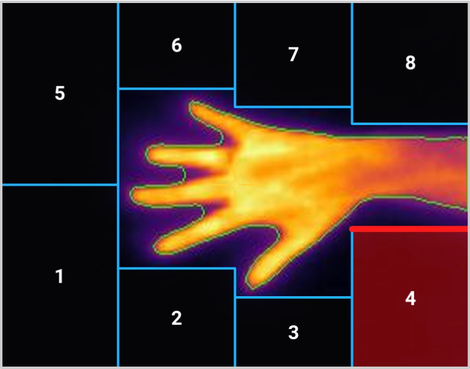
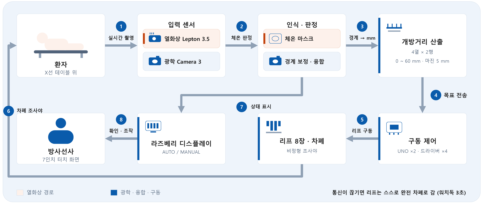
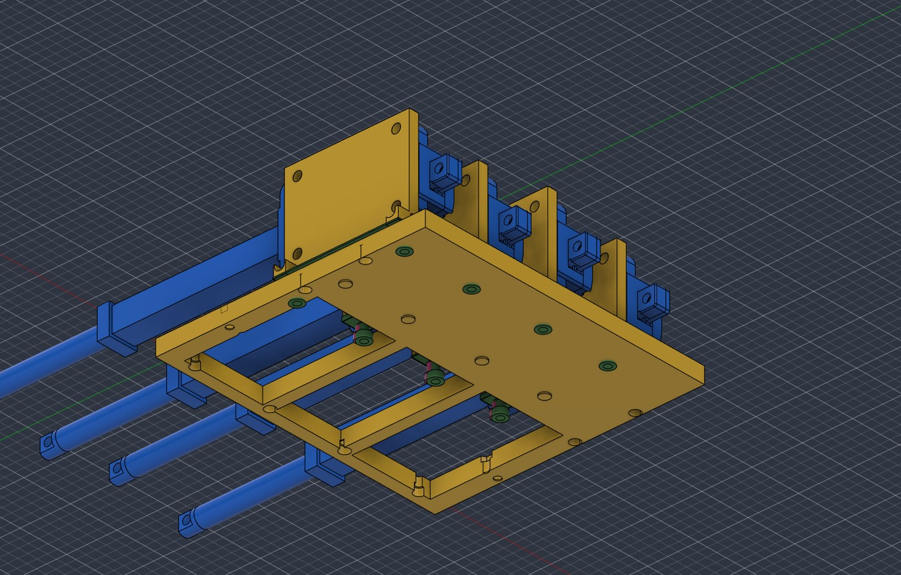
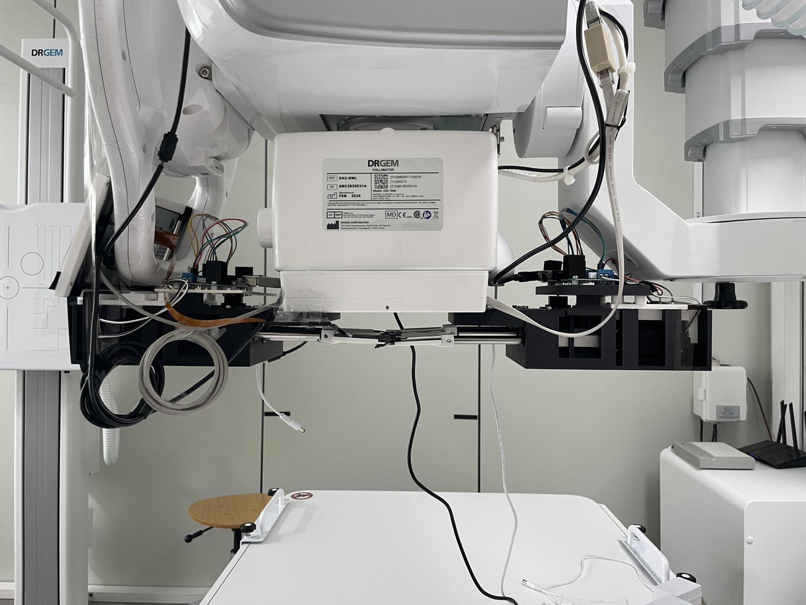
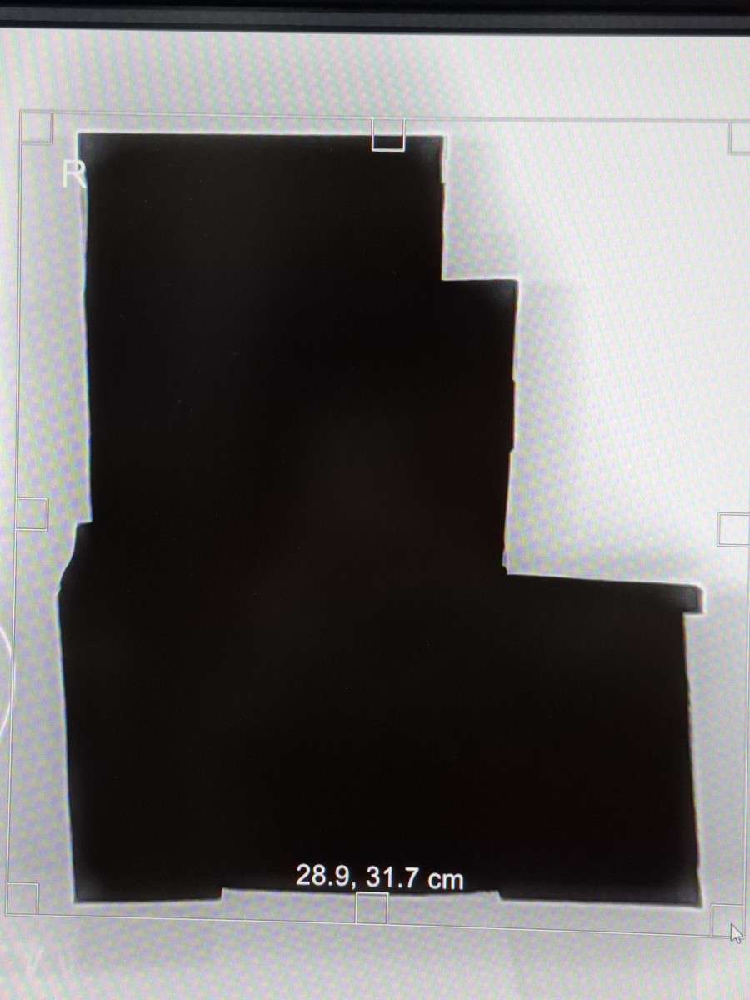

# 26_HS074 · AI 기반 다엽 콜리메이터를 활용한 환자 맞춤형 방사선 저감화 시스템

2026 한이음 드림업 공모전 · 장애인 및 소아 환자의 의료 안전망 구축을 위한 AI 방사선 저감화 시스템 개발

---

## 💡1. 프로젝트 개요

**1-1. 프로젝트 소개**
- 프로젝트 명 : 장애인 및 소아 환자의 의료 안전망 구축을 위한 AI 방사선 저감화 시스템 개발
- 프로젝트 정의 : 열화상 카메라로 환자의 체형을 비접촉으로 인식하고, 리니어 액추에이터로 움직이는 납 차폐판 8장(2행 4열 다엽 콜리메이터, MLC)이 체형 외곽에 맞춰 엑스선 조사야(방사선이 나가는 범위)를 자동으로 좁히는 환자 맞춤형 방사선 저감화 시스템



**1-2. 개발 배경 및 필요성**
- 스스로 자세를 유지하기 어려운 소아·장애인·절단 환자는 조금만 움직여도 재촬영하게 되어, 찍을 때마다 같은 피폭이 다시 더해짐 (소아 일반엑스선 재검사율 7.7~13.55% 보고, 원인 1·2위가 움직임과 위치 오류)
- 환자를 붙잡아 주는 보호자는 환자 몸에서 튀어 나온 방사선(산란선)에 함께 노출되고, 방사선사는 자세 보조와 조사야 조절을 동시에 떠안음
- 현행 조사야는 사람이 손으로 맞추는 사각형이라 체형을 반영하지 못하며, 사각형과 몸 사이의 여백이 그대로 불필요한 피폭이 됨

**1-3. 프로젝트 특장점**
- 장비 중심 기술(자동노출조절·영상 재구성)과 달리 환자 개별 체형을 직접 반영해 "어디를 조사하는가"를 바꿈
- 방사선을 쓰지 않는 비접촉 열화상으로 체온에서 체형을 분리 (담요를 덮어도 인식)
- 사각형 조사야 대신 리프 8장의 비정형 능동 차폐
- 실패안전 : 통신이 끊기면(워치독 3초) 리프가 완전 차폐로 가고, 인체가 없는 열은 열지 않음
- 기존 X선 장비를 개조하지 않고 덧붙이는 부착형

**1-4. 주요 기능**
- 열화상 기반 인체 자동 인식 : 온도 임계 이진화 + 형태학 연산 + 연결성분 면적 필터로 인체만 분리
- 윤곽 추적과 실제 면적(cm²) 변환 : SID 100cm·12×12cm 조사야 기준 보정
- 리프 개방거리 실시간 산출 : 조사야를 4열로 나눠 열마다 인체 최상단까지의 거리 + 안전 마진 5mm → 0~60mm
- MLC 능동 차폐 : Arduino UNO 2대 + L298N 4장 + 리니어 액추에이터 8개 개별 구동
- 평면보정(FFC) 자동화 : 90초 주기로 열화상 잔상·온도 드리프트 제거
- 코어·화면 분리 : 판정·구동 코어와 7인치 터치 화면을 별도 프로세스로 나누고 TCP 소켓으로 연결 (화면이 멈춰도 차폐 유지)

**1-5. 기대 효과 및 활용 분야**
- 측정 결과 (정상 성인, 방사선사 수동 조사야 대비 장치 자동 조사야의 면적선량)
  - 손 후전방향(Hand PA) 5명 : **−28.78%**
  - 어깨 측방향(Shoulder Lat) 10명 : **−43.05%** (p = 0.002)
- 기대 효과 : 촬영 1회당 선량과 누적 피폭 감소, 산란선 감소로 보호자 2차 피폭 감소(향후 측정), 조사야 조절 시간을 환자 케어에 사용
- 활용 분야 : 이동형 방문 검진, 장애친화 의료기관, 소아과·정형외과

**1-6. 기술 스택**
- 언어 : Python, Arduino(C++)
- 영상 처리 : OpenCV, NumPy
- 화면(GUI) : PyQt, 7인치 터치 디스플레이
- 하드웨어 : Raspberry Pi 5, FLIR Lepton 3.5 + PureThermal 3, Raspberry Pi Camera Module 3, Arduino UNO ×2, L298N ×4, 리니어 액추에이터(행정 75mm) ×8
- 통신 : USB 시리얼(115200bps), TCP 소켓(127.0.0.1:9977, JSON)
- 설계 : Autodesk Fusion (1:1 3D 모델링), FDM 3D 프린팅

---

## 💡2. 팀원 소개

| 학생 | 학생 | 학생 | 학생 | 학생 | 지도교수 | 지도교수 | 멘토 |
|:---:|:---:|:---:|:---:|:---:|:---:|
| **조장** | **팀원1** | **팀원2** | **팀원3** | **팀원4** | **지도교수1** | **지도교수2** | **멘토** |
| • 하드웨어 설계 및 열화상 카메라·X선 장비 연동 | • AI 기반 조사야 인식 및 콜리메이터 자동 조절 시스템 개발 | • 프로젝트 기획 및 자료 조사, 관련 선행연구 분석 | •실험 설계 및 수동·자동 조절 방식의 데이터 수집| • 실험 결과 분석, 감소율 계산 및 논문·발표 자료 작성 | • 지도·자문 | • 프로젝트 멘토 |

---

## 💡3. 시스템 구성도

- 서비스 흐름도 : 열화상 카메라 → Raspberry Pi 5 코어(체온 판정·윤곽 추적·개방거리 산출) → USB 시리얼 → Arduino UNO 2대 → L298N 4장 → 리니어 액추에이터 8개 → 납 리프가 체형 외곽에 맞춰 이동



- H/W 구성도 (MLC 구동부 3D 모델)



- 실제 X선 장비 헤드에 부착한 모습



- 결과 : 디텍터에 찍힌 체형 맞춤 조사야



---

## 💡4. 작품 소개영상

<!-- [](유튜브 영상 주소) -->https://www.youtube.com/watch?si=nMOO3sSLv_0f5RjP&v=jxMwJrnFLvk&feature=youtu.be

---

## 💡5. 핵심 소스코드

**폴더 구성**
```
src/
├─ raspberry_pi/          Raspberry Pi 5 에서 실행 (Python)
│  ├─ mlc_core.py         코어: 열화상 취득 → 인체 판정 → 리프 개방거리 → 아두이노 전송, 워치독
│  ├─ thermal_ui2.py      7인치 터치 운전 화면 (코어에 TCP 소켓으로 접속)
│  ├─ leaves.py           인체 분리 · 외곽선 · 리프 개방거리 계산 (핵심 알고리즘)
│  ├─ lepton.py / ffc.py  FLIR Lepton 3.5 취득 · 평면보정(FFC) 자동화
│  ├─ field.py            조사야 격자(0.5mm/px) 변환 · 보정
│  ├─ optical.py          광카메라(Camera Module 3) 취득
│  ├─ mlc_driver.py       아두이노 시리얼 통신
│  ├─ mlc_client.py       화면 ↔ 코어 소켓 클라이언트
│  ├─ mlc_mock.py         장비 없이 화면을 개발하는 가짜 코어
│  ├─ MLC_소켓규약.md      코어 ↔ 화면 통신 규약
│  ├─ 설치_실행_안내.md     라즈베리 파이 설치 · 실행 방법
│  └─ 그 밖의 파일          보정 · 진단 · 시험 도구 (align_measure, field_measure, test_ch 등)
└─ arduino/
   └─ AMLA_8CH_75MM/      Arduino UNO 펌웨어 (2대에 같은 펌웨어, 각 4채널 · 통신 끊김 시 완전 차폐)
```

**실행 (Raspberry Pi 5)**
```bash
sudo apt install -y python3-opencv python3-numpy python3-serial python3-picamera2 v4l-utils
python3 mlc_core.py        # 코어
python3 thermal_ui2.py     # 터치 화면 (VNC 안의 터미널에서)
```

**핵심 코드 : 조사야를 4열로 나눠 열마다 리프 개방거리 계산** (`src/raspberry_pi/leaves.py`)
- 열마다 인체가 가장 위에 나타나는 점을 찾아, 상·하 리프가 맞물리는 중심선까지의 거리에 안전 마진 5mm 를 더함
- 인체가 없는 열은 0mm (완전 차폐) — 실패하면 항상 닫히는 쪽으로 감

```python
def openings_from_profile(profile, mask, grid_h, grid_w, mm_per_px,
                          n_cols=N_COLS, margin_mm=MARGIN_MM,
                          leaf_max_mm=LEAF_TRAVEL_MM, min_band_mm2=MIN_BAND_MM2):
    mid = grid_h // 2
    limit = min(float(leaf_max_mm), mid * mm_per_px)
    min_band_pix = max(1, int(round(min_band_mm2 / (mm_per_px ** 2))))

    openings = []
    infos = []
    for c in range(n_cols):
        x0 = (c * grid_w) // n_cols
        x1 = ((c + 1) * grid_w) // n_cols

        band = mask[:, x0:x1]
        pix = int(np.count_nonzero(band))
        seg = profile[x0:x1]
        seg = seg[seg >= 0]

        if pix < min_band_pix or seg.size == 0:
            # 그 열에 인체가 없으면 완전 차폐. 찍을 것이 없으니 닫는 게 맞습니다.
            openings.append(0.0)
            infos.append({"y_top": None, "pix": pix, "clamped": False})
            continue

        y_top = int(seg.min())                    # 그 열에서 가장 위에 있는 인체 점
        d_mm = (mid - y_top) * mm_per_px          # 중심선 위로 얼마나 올라와 있나
        want = d_mm + margin_mm
        open_mm = float(np.clip(want, 0.0, limit))
        openings.append(open_mm)
        infos.append({"y_top": y_top, "pix": pix, "clamped": want > limit + 1e-6})

    return openings, infos
```

**핵심 코드 : 열화상에서 인체만 분리** (`src/raspberry_pi/leaves.py` 의 `body_mask`)
```python
m = ((temp_c >= tmin) & (temp_c <= tmax)).astype(np.uint8) * 255
m = cv2.morphologyEx(m, cv2.MORPH_OPEN, K3)     # 점 노이즈 제거
m = cv2.morphologyEx(m, cv2.MORPH_CLOSE, K9)    # 구멍 메우기 + 끊긴 부분 잇기
n, labels, stats, _ = cv2.connectedComponentsWithStats(m, 8)
# 너무 작은 덩어리만 버린다. 손가락 하나도 남겨야 한다.
```
